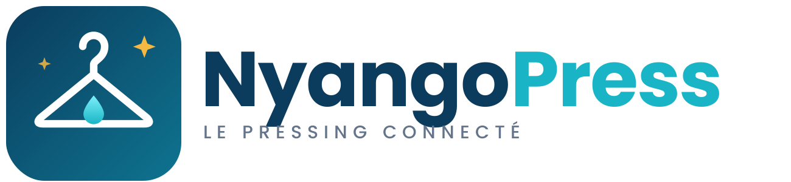
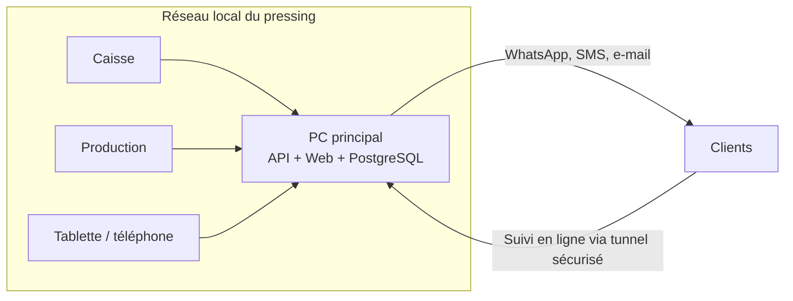

<p align="center">
  
</p>

<p align="center"><b>La plateforme de gestion de pressing connectée</b><br>
Traçabilité par QR code · Notifications WhatsApp / SMS / e-mail · Livraison suivie en direct · Fidélité · Stocks · Tableaux de bord</p>

<p align="center">
  
  
  
  
  
</p>

---

## Sommaire
1. [Présentation](#1-présentation)
2. [Fonctionnalités](#2-fonctionnalités)
3. [Pile technique](#3-pile-technique)
4. [Architecture](#4-architecture)
5. [Démarrage rapide](#5-démarrage-rapide)
6. [Structure du dépôt](#6-structure-du-dépôt)
7. [Rôles utilisateurs](#7-rôles-utilisateurs)
8. [Documentation](#8-documentation)
9. [Équipe et organisation](#9-équipe-et-organisation)
10. [Feuille de route](#10-feuille-de-route)
11. [Licence](#11-licence)

## 1. Présentation

**NyangoPress** gère tout le cycle de vie d'une commande de pressing : dépôt, inspection avec photos, traitement article par article, contrôle qualité, rangement, retrait ou livraison, paiement, fidélité.
Chaque vêtement possède un **QR code** ; le client est prévenu **automatiquement** à chaque étape par WhatsApp, SMS ou e-mail, reçoit des **rappels** avant la date de retrait et des **relances** s'il ne vient pas.
Toute l'équipe travaille sur **la même base de données**, hébergée sur un PC principal du réseau local.

> Projet universitaire et commercial, réalisé par une équipe de 5 développeurs.

## 2. Fonctionnalités

| Domaine | Points forts |
|---|---|
| **Commandes** | Dépôt guidé, photos d'état, QR par article, file de production (kanban), plan de stockage, signature de retrait |
| **Clients** | Recherche instantanée, préférences de canal et de langue, historique, clients professionnels (facturation mensuelle) |
| **Paiements et documents** | Acompte, partiel, mobile money, tickets 80 mm, reçus et factures PDF, impression, envoi automatique |
| **Notifications** | WhatsApp, SMS, e-mail, in-app ; suivi d'avancement, rappels, relances d'abandon, alertes de stock ; file fiable avec reprise |
| **Livraison** | Collecte et livraison à domicile, tournées, application livreur, suivi GPS en temps réel, code de remise |
| **Fidélité** | Points, **NyangoJetons**, paliers Bronze à Platine, récompenses, parrainage |
| **Stocks et achats** | Produits, seuils, inventaire, fournisseurs, bons de commande envoyés automatiquement, équipements et maintenance |
| **Pilotage** | Tableau de bord avec filtres, rapports financiers et de ventes, performance des employés, exports Excel et PDF, imports |
| **Sécurité** | Mots de passe hachés et salés, 2FA Google Authenticator, rôles stricts, audit complet, limitation de débit |
| **Multilingue** | Français et anglais partout : interface, PDF, notifications |
| **Innovations** | Articles non réclamés et enchères, assistant détachage, prévision d'affluence, relance des clients inactifs, PWA |

La liste complète et priorisée (P0, P1, P2) est dans le [cahier des charges](NyangoPress_Cahier_des_Charges.pdf).

## 3. Pile technique

C# 14 · .NET 10 · ASP.NET Core · Blazor + MudBlazor · EF Core + PostgreSQL 17 · SignalR · Hangfire · QuestPDF · ClosedXML · QRCoder · Serilog · FluentValidation · xUnit · GitHub Actions · Docker Compose

## 4. Architecture

Monolithe modulaire en couches : `Domain` → `Application` → `Infrastructure` → `Api` / `Web`.
Les diagrammes (déploiement, cas d'utilisation, entité-relation, états, séquence) sont dans [docs/ARCHITECTURE.md](docs/ARCHITECTURE.md).



## 5. Démarrage rapide

**Prérequis :** .NET 10 SDK, Git, Docker Desktop, un éditeur (Visual Studio, Rider ou VS Code + C# Dev Kit).
Le guide pas à pas complet est dans [docs/GUIDE_DEMARRAGE.md](docs/GUIDE_DEMARRAGE.md).

```bash
git clone https://github.com/<organisation>/NyangoPress.git
cd NyangoPress
cp docker/.env.example docker/.env          # puis éditer les mots de passe
docker compose -f docker/docker-compose.yml --env-file docker/.env up -d

dotnet user-secrets set "ConnectionStrings:Default" "Host=localhost;Port=5432;Database=nyangopress;Username=nyango;Password=<votre mot de passe>" --project src/NyangoPress.Api
dotnet ef database update --project src/NyangoPress.Infrastructure --startup-project src/NyangoPress.Api
dotnet run --project src/NyangoPress.Api
dotnet run --project src/NyangoPress.Web
```

Services de développement : pgAdmin http://localhost:5050 · Mailpit (e-mails de test) http://localhost:8025.
Les ports de l'API et du Web sont affichés au démarrage (voir `launchSettings.json`).

## 6. Structure du dépôt

```
NyangoPress/
├─ src/
│  ├─ NyangoPress.Domain          Entités et règles métier
│  ├─ NyangoPress.Application     Cas d'usage, interfaces, validateurs
│  ├─ NyangoPress.Infrastructure  EF Core, notifications, PDF, Excel, Identity
│  ├─ NyangoPress.Shared          Contrats partagés API et Web
│  ├─ NyangoPress.Api             Endpoints, SignalR, Hangfire
│  └─ NyangoPress.Web             Interface Blazor (MudBlazor)
├─ tests/                         Tests unitaires et d'intégration
├─ docs/                          Documentation technique
├─ assets/branding/               Logo et charte
├─ docker/                        Compose et configuration
└─ .github/                       CI, modèles de PR et de tickets
```

## 7. Rôles utilisateurs

| Rôle | Accès |
|---|---|
| Administrateur | Tout, plus sécurité, audit, paramètres, sauvegardes |
| Manager | Employés, finances, stocks, fournisseurs, rapports |
| Caissier | Dépôts, retraits, encaissements, clients |
| Opérateur | File de production, scan QR |
| Livreur | Missions de livraison |
| Client | Suivi de ses commandes, points |

## 8. Documentation

| Document | Contenu |
|---|---|
| [Cahier des charges](NyangoPress_Cahier_des_Charges.pdf) | Spécifications complètes |
| [Plan d'action et répartition](NyangoPress_Plan_Action_Repartition.pdf) | Qui fait quoi, jour par jour |
| [docs/ARCHITECTURE.md](docs/ARCHITECTURE.md) | Architecture et diagrammes |
| [docs/GUIDE_DEMARRAGE.md](docs/GUIDE_DEMARRAGE.md) | Prérequis, création du dépôt, première installation |
| [docs/GUIDE_GIT.md](docs/GUIDE_GIT.md) | Workflow Git, branches, migrations |
| [docs/CONVENTIONS.md](docs/CONVENTIONS.md) | Conventions de code et de nommage |
| [docs/SECURITE.md](docs/SECURITE.md) | Sécurité et checklist |
| [docs/NOTIFICATIONS.md](docs/NOTIFICATIONS.md) | Canaux, modèles, comptes à créer |
| [docs/DEPLOIEMENT_LAN.md](docs/DEPLOIEMENT_LAN.md) | Installation sur le PC principal |
| [CONTRIBUTING.md](CONTRIBUTING.md) | Règles pour contribuer |

## 9. Équipe et organisation

| Dév | Rôle | Modules |
|---|---|---|
| Dev 1 | Lead technique, sécurité | Authentification, employés, audit, paramètres |
| Dev 2 | Cœur métier | Clients, commandes, production, livraison, enchères |
| Dev 3 | Finance et documents | Catalogue, paiements, PDF, fidélité, rapports |
| Dev 4 | Interface | Design system, multilingue, écrans signature, portail |
| Dev 5 | Notifications et logistique | Notifications, stocks, fournisseurs, tâches planifiées |

Remplacez ce tableau par les noms et profils GitHub de l'équipe.

## 10. Feuille de route

- [ ] **J1** Fondations, CI, design system, contrats
- [ ] **J2** Authentification, clients, catalogue, moteur de notification
- [ ] **J3** Commandes complètes, paiements, tickets PDF
- [ ] **J4** Production, notifications d'étapes, rappels, tableau de bord (fin des P0)
- [ ] **J5** Livraison, fidélité, 2FA, rapports, inventaire
- [ ] **J6** Finitions, enchères, innovations, i18n complet (gel des fonctionnalités)
- [ ] **J7** Stabilisation et version 1.0

## 11. Licence

À définir par l'équipe (projet universitaire et commercial). Tant qu'aucune licence n'est choisie, tous droits réservés.
