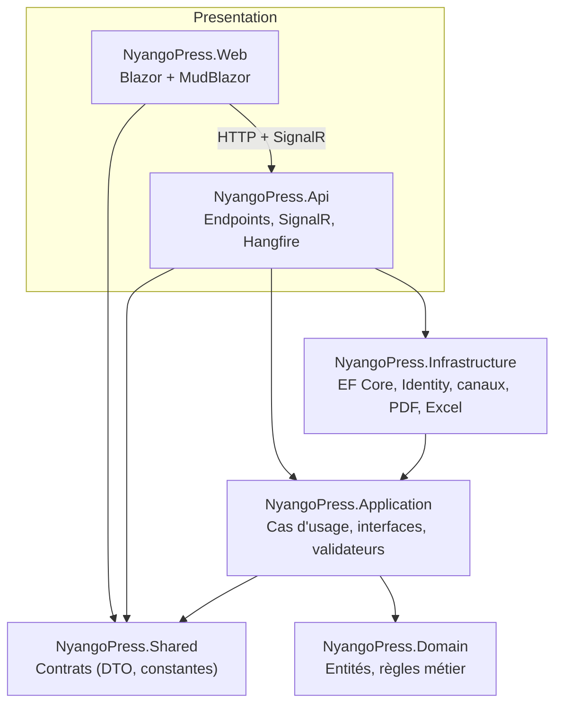
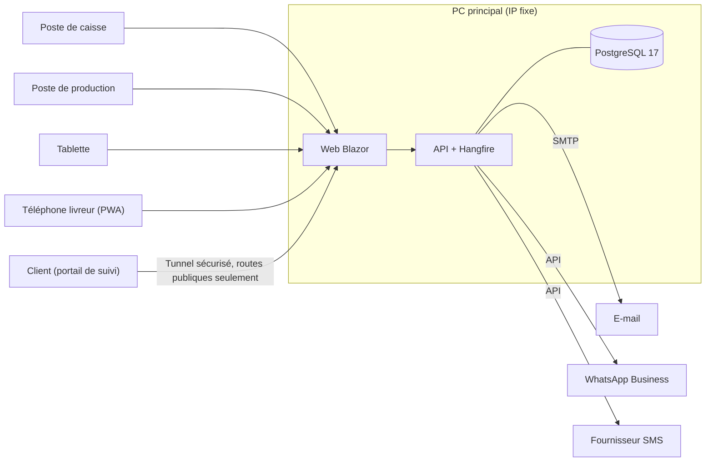
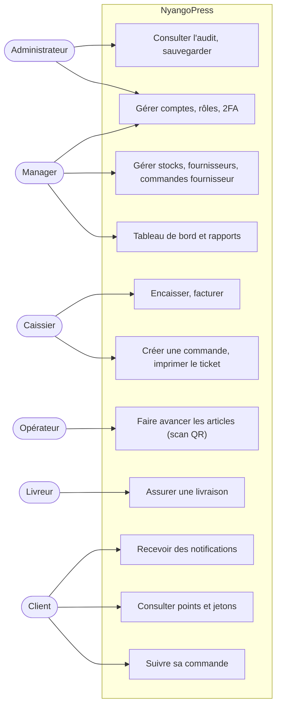
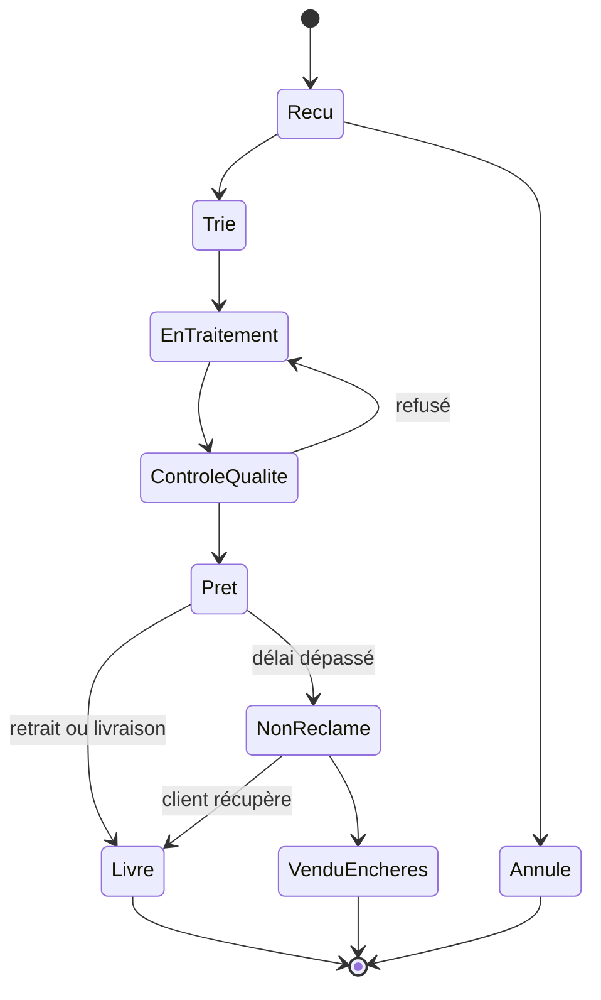
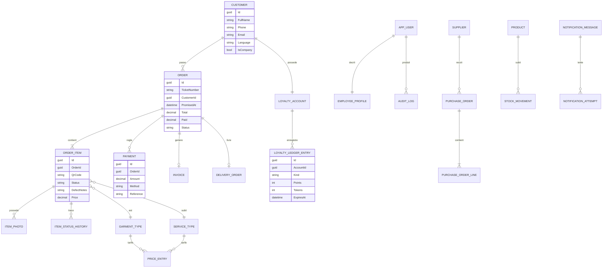
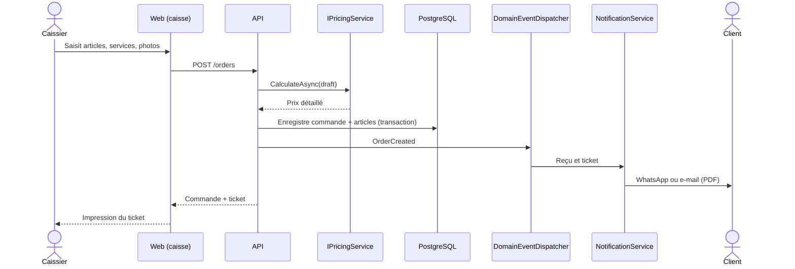
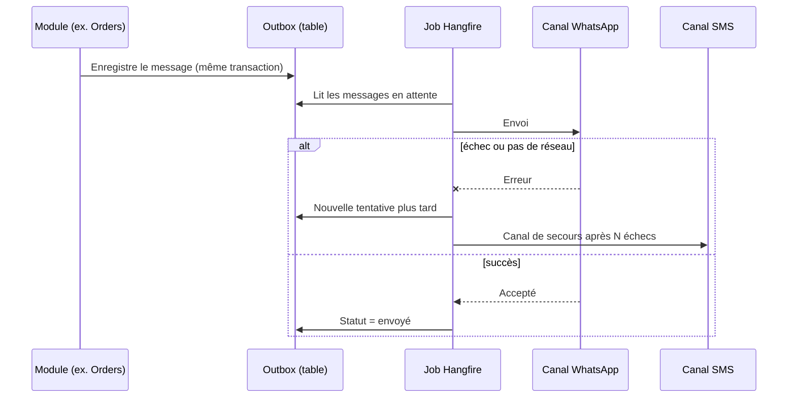
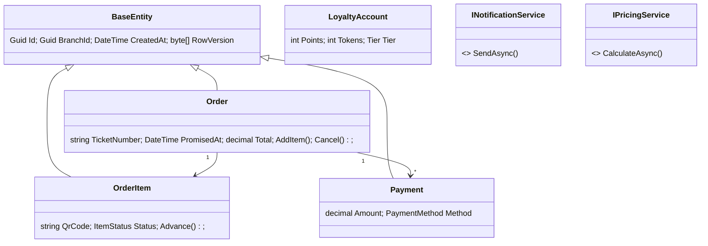

# Architecture de NyangoPress

Tous les diagrammes sont en Mermaid : ils s'affichent directement sur GitHub.

## 1. Vue d'ensemble

Monolithe modulaire en couches. Chaque module métier (Orders, Payments, Notifications...) a un dossier dans chaque couche.

**Règles de dépendance :** `Domain` ne dépend de rien. `Application` dépend de `Domain` et `Shared`. `Infrastructure` implémente les interfaces d'`Application`. `Web` ne parle jamais à la base : uniquement à l'API.

## 2. Déploiement sur le réseau local

## 3. Cas d'utilisation

## 4. États d'un article

`EnTraitement` contient les sous-étapes détachage, lavage ou nettoyage à sec, séchage, repassage.
La machine d'états est codée dans `Domain/Orders/ItemStateMachine.cs` et testée de façon exhaustive : toute transition non listée est refusée.

## 5. Modèle de données (noyau)

Toutes les entités métier ont : `Id`, `BranchId`, `CreatedAt`, `CreatedBy`, `UpdatedAt`, `UpdatedBy`, `RowVersion` (concurrence optimiste).

## 6. Séquence : dépôt d'une commande

## 7. Séquence : notification fiable

## 8. Classes principales (extrait)

## 9. Communication entre modules

Les modules ne s'appellent pas directement dans les deux sens. Pour éviter les dépendances circulaires :

- **Appel synchrone** (réponse immédiate nécessaire) : via une interface déclarée dans `Application` (ex. `IPricingService`).
- **Événement** (réaction sans attendre) : via `IDomainEventDispatcher` (ex. `OrderStatusChanged` écouté par Notifications).
- **Lecture** : via une interface de requêtes en lecture seule (ex. `IOrderQueries`).

## 10. Décisions d'architecture

| Décision | Raison |
|---|---|
| Web + API (pas WPF) | Responsive, accessible depuis tout appareil, portail client possible |
| Blazor + MudBlazor | Même langage C# partout, composants graphiques riches, productivité |
| PostgreSQL | Fiable en réseau local, recherche rapide (pg_trgm), sauvegardes simples |
| Monolithe modulaire | Équipe de 5, 7 jours : simple à déployer et à déboguer |
| Outbox + Hangfire | Aucune notification perdue si le réseau tombe |
| Registre de fidélité immuable | Soldes vérifiables, pas de triche possible |
| `decimal` pour l'argent | Pas d'erreur d'arrondi |
| `BranchId` partout dès J1 | Multi-succursales sans refonte |
