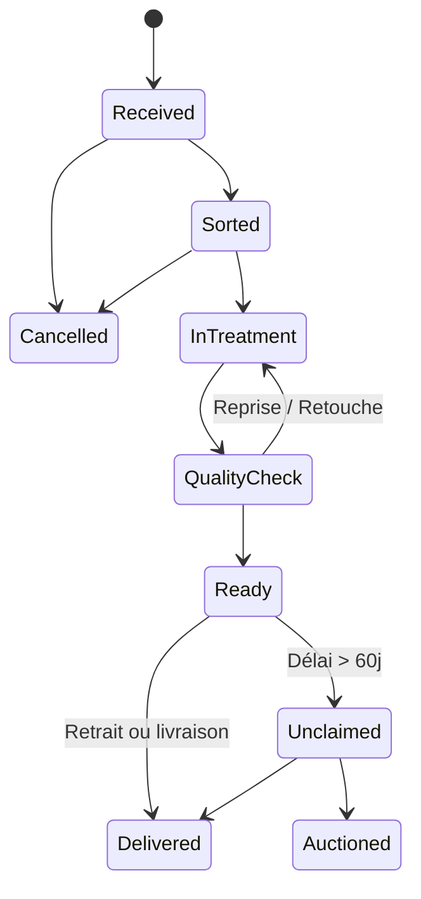

# Module Commandes, Production & Stockage (Dev 2 — M05)

## Périmètre couvert
- `ORD-01` à `ORD-11` : Assistant de dépôt 4 étapes, inspection avec défauts et photos, étiquettes QR uniques par article (`QRCoder`), machine d'états stricte, Kanban temps réel (`OrdersHub`), estimation intelligente de la date de retrait selon la charge, plan de stockage (Allée-Rack-Cintre), retrait avec contrôle du solde (`RG-03`) et signature numérique, réclamations/litiges, annulation motivée et auditée, acceptation des CGV.

## Machine d'états des articles (`ItemStateMachine.cs`)

## Contrats exposés aux autres développeurs
- `IOrderQueries` (`src/NyangoPress.Application/Orders/IOrderQueries.cs`) : lecture seule pour Dev 3 (rapports) et Dev 5 (jobs rappels J-2/J-1/J, relances d'abandon, clients inactifs).
- Événements de domaine : `OrderCreatedEvent`, `OrderStatusChangedEvent`, `OrderCancelledEvent`, `OrderPickedUpEvent`, `ClaimOpenedEvent`.

## Endpoints API
- `GET /api/orders`, `GET /api/orders/{id}`, `POST /api/orders`, `POST /api/orders/preview-price`, `POST /api/orders/estimate-pickup-date`
- `POST /api/orders/{id}/pickup`, `POST /api/orders/{id}/cancel`, `POST /api/orders/{id}/claims`, `PUT /api/orders/claims/{claimId}/resolve`
- `GET /api/production/queue`, `POST /api/production/items/{itemId}/status`, `POST /api/production/scan`, `GET /api/production/items/{qrCode}/qr.svg`
- `GET /api/storage/locations`, `POST /api/storage/locations`, `POST /api/storage/items/{itemId}/assign`
- SignalR : `/hubs/orders`
